# VisuoDiT: Visuomotor Diffusion Transformer for Square-Nut Assembly

VisuoDiT is a closed-loop visuomotor policy for contact-rich manipulation. A 7-DoF Franka Emika Panda, simulated in Robosuite 1.4.1 on MuJoCo, learns the Robomimic *square* task: grasp a square nut and seat it on a designated peg. The policy is a conditional denoising diffusion probabilistic model. A pair of ResNet-18 encoders maps a single-timestep, two-camera observation into a compact condition vector. A shallow diffusion transformer (DiT) then represents the distribution over a short-horizon action chunk by learning to reverse a fixed Gaussian noising process. At execution time the same network is queried as an ancestral sampler, the first actions of the denoised chunk are applied open-loop, and the loop closes on a fresh observation.

Training is purely imitative. The objective never sees a reward. It matches the conditional distribution of proficient-human action chunks given the current image and proprioception. A sparse task reward is used only afterwards, as an evaluation statistic.

<p align="center">
  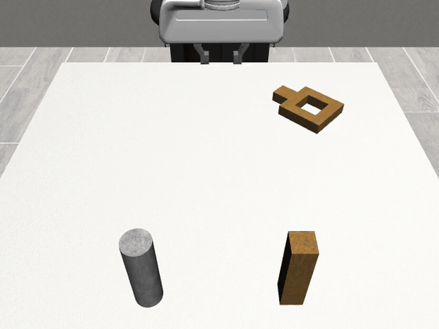
</p>
<p align="center"><em>One recorded demonstration of a successful assembly. The arm picks up the square nut and sets it on the brass peg.</em></p>

<p align="center">
  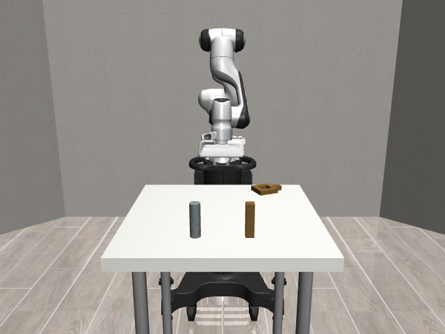
  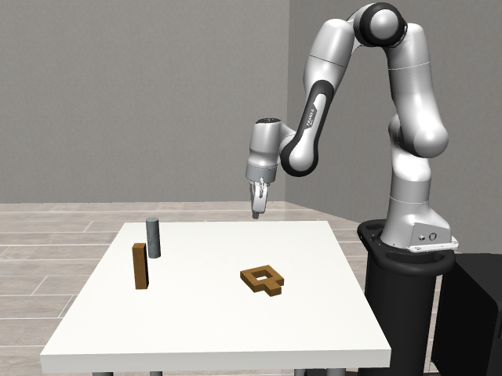
  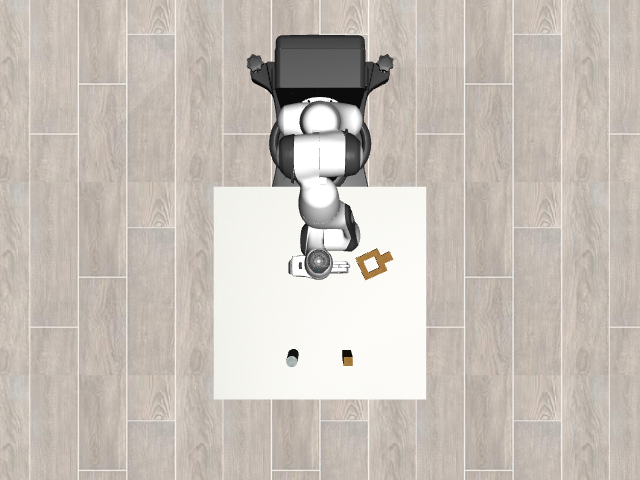
</p>
<p align="center"><em>Workspace geometry from the front, the side, and above. These views are for inspection. They are not policy inputs.</em></p>

## Task

The environment is `NutAssemblySquare`. Two pegs stand on the table. The brass rectangular post is the target: success requires the square nut to be seated on that post. The gray cylinder is the peg for a round nut and is not part of this variant. The nut is the gold body with the square bore. Initial object pose is randomized by the environment’s placement sampler, so a competent policy has to localize the nut visually rather than replay a fixed joint trajectory.

The low-level interface is an operational-space pose controller (`OSC_POSE`) running at 20 Hz, with delta position limits of 5 cm and delta orientation limits of 0.5 rad per command. The policy does not output joint torques. It outputs the 7-dimensional controller command the demonstrations were recorded in: a translational delta, an axis-angle rotational delta, and a gripper command. Actions are relative (`control_delta=True`). An episode is capped at 500 environment steps, which is 25 seconds of simulated control.

The demonstrations are the Robomimic proficient-human (`ph`) image set for this task. Each trajectory is a successful human teleoperation. The dataset stores both cameras, end-effector pose, gripper aperture, and the action that was applied. On disk the image release is about 2.6 GB. At train time it is converted once into a temporal zarr replay buffer, with RGB frames stored under a JPEG 2000 codec, and then sampled as fixed-length windows.

<p align="center">
  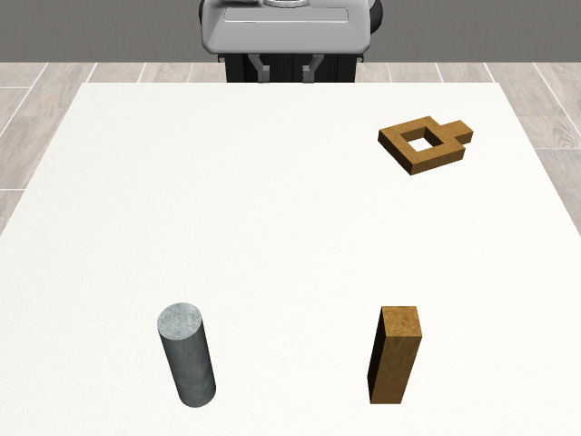
  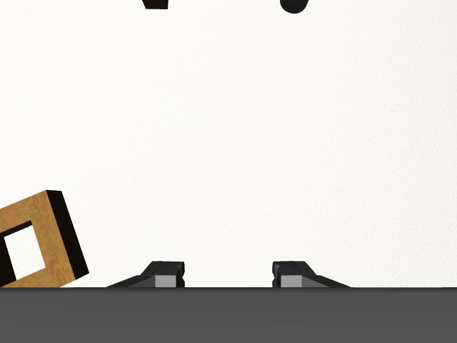
</p>
<p align="center"><em>Left: the external agent view. Right: the wrist-mounted eye-in-hand view, with the fingers along the bottom of the frame. Both are 84×84 RGB at the network input.</em></p>

## Observation and action

A training tuple is one observation and the action chunk that follows it. History is not stacked. The encoder sees the world at a single time index, and the diffusion model is asked to explain the next $T = 10$ actions conditioned on that instant. With a 20 Hz controller, ten actions are half a second of commands. The execution horizon is shorter than the prediction horizon: the first $T_a = 8$ actions are applied, then the cameras are read again. That is a receding-horizon, action-chunked controller. Predicting past the execution horizon gives the denoiser a little future context; discarding the tail limits how long the arm moves without visual feedback. Near the end of a demonstration the chunk is padded after the last real action (`pad_before = 0`, `pad_after = 7`).

The observation $o$ has two modalities.

**Vision.** `agentview_image` and `robot0_eye_in_hand_image`, each $3 \times 84 \times 84$, RGB, scaled to $[0, 1]$. The two cameras do not share an encoder. The external camera sees the table, both pegs, and the approach. The wrist camera sees the fingers and whatever is between them, which is the signal that matters once the nut is grasped and the external view is partly occluded by the forearm.

**Proprioception.** Nine scalars, left un-noised:

| Signal | Dimension | Representation |
|---|---|---|
| `robot0_eef_pos` | 3 | End-effector position in the world frame |
| `robot0_eef_quat` | 4 | End-effector orientation as a unit quaternion, (x,y,z,w) |
| `robot0_gripper_qpos` | 2 | Opening of the two fingers |

Orientation is a quaternion, not Euler angles. A quaternion is a 4-vector on the 3-sphere. It encodes a 3-dimensional rotation without the gimbal singularities of pitch-roll-yaw, at the cost of a double cover: $q$ and $-q$ are the same rotation. The dataset conversion writes the Robosuite quaternion into xyzw order before it is normalized and concatenated.

The action $a_t \in \mathbb{R}^7$ is

$$
a_t = \big(\Delta x,\ \Delta y,\ \Delta z,\ \Delta r_x,\ \Delta r_y,\ \Delta r_z,\ g\big),
$$

a Cartesian translational delta, an axis-angle rotational delta, and one gripper command. Each coordinate is min-max normalized to $[-1, 1]$ using statistics of the demonstration set, and unnormalized back to controller units only after sampling. The diffusion process lives entirely in that normalized box. Images and proprioception are conditions. Only the action chunk is corrupted.

## Architecture

Two modules are trained jointly. `MultiImageObsCondition` is a perception front-end: it answers which scene produced this tuple. `DiT1d` is a conditional denoiser: it answers which noise was added to the action chunk, given that scene and a diffusion-time index. Gradients flow through both. There is no frozen visual backbone and no ImageNet initialization. Both ResNets start from random weights, because the synthetic Robosuite appearance is far from natural photographs and the batch statistics of a small imitation dataset are a poor match for a network pretrained on ImageNet.

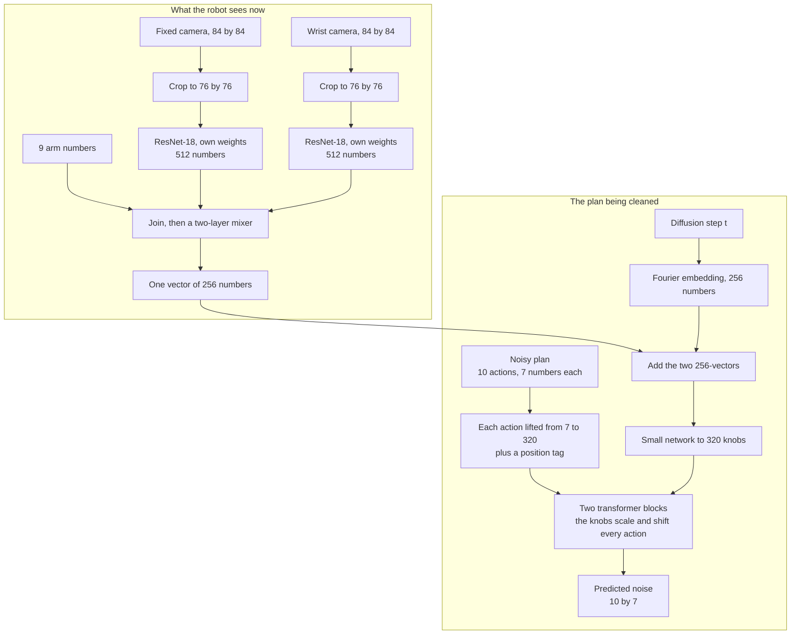

### Visual backbone

Each camera is cropped from $84 \times 84$ to $76 \times 76$ before the stem. During training the crop window is drawn uniformly inside the image (`CropRandomizer`), which is a spatial augmentation: the encoder cannot rely on a nut sitting on one fixed pixel. At evaluation the crop is centered, so test-time features are deterministic given the raw frame. Batch normalization is replaced, everywhere in both ResNets, by GroupNorm with $C/16$ groups. GroupNorm computes mean and variance inside each sample, so the encoder’s behavior does not depend on the other images in the minibatch. That matters twice: the training batch is only 64, and evaluation runs at batch size 1.

A residual stage does not collapse the image to a vector. It preserves a spatial feature grid. One BasicBlock is two $3 \times 3$ convolutions, each followed by GroupNorm, with a ReLU between them and another ReLU after the residual add. When stride or channel count changes, the skip path is a $1 \times 1$ convolution plus GroupNorm, so the add is shape-compatible. Otherwise the skip is the identity. Each camera’s ResNet-18 contains eight such blocks, two in each of the four stages.

From a $76 \times 76$ crop the spatial contract is:

| Stage | Operator | Output grid |
|---|---|---|
| Stem | 7×7 convolution, 64 channels, stride 2, then 3×3 max pool | 19×19×64 |
| Stage 1 | two residual blocks, stride 1 | 19×19×64 |
| Stage 2 | two residual blocks, first stride 2 | 10×10×128 |
| Stage 3 | two residual blocks, first stride 2 | 5×5×256 |
| Stage 4 | two residual blocks, first stride 2 | 3×3×512 |
| Pool | global average pool over the spatial axes, classification head removed | ℝ⁵¹² |

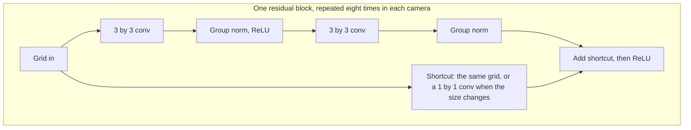

Global average pooling is the first moment at which a camera becomes a single vector. Until then, every channel still has a spatial layout, and the residual adds are elementwise on that layout. The two 512-dimensional descriptors are concatenated with the 9 proprioceptive scalars, giving a 1033-dimensional observation code. A two-layer MLP compresses it:

$$
1033 \xrightarrow{\ \mathrm{Linear}\ } 256 \xrightarrow{\ \mathrm{LeakyReLU}\ } 256 \xrightarrow{\ \mathrm{Linear}\ } 256.
$$

Call this condition $c \in \mathbb{R}^{256}$. It is the only visual information the transformer receives. Raw pixels and the 1033-dimensional concatenation are not tokens, and they are not appended to the action sequence.

### Diffusion transformer

`DiT1d` is a 1-D DiT over the action horizon, not over image patches. The sequence length is 10. The token dimension starts at 7 and is lifted to $d = 320$. Depth is 2 blocks. Attention uses 10 heads, so each head has dimension 32. The design follows the adaptive layer-norm conditioning of Peebles and Xie, reduced to a short sequence because the object being denoised is an action chunk rather than a latent image.

There are two paths, and they meet only inside the blocks.

**Sequence path.** A noisy chunk $x_t \in \mathbb{R}^{10 \times 7}$ is projected by a learned linear map $W_x \in \mathbb{R}^{320 \times 7}$ and added to a fixed sinusoidal position embedding of the horizon index $0,\ldots,9$. The position embedding marks which token is the immediate command and which tokens are further into the chunk. It is not an embedding of the diffusion time. After this projection the sequence is $10 \times 320$, and that is what self-attention attends over. Attention is bidirectional across the horizon: every action in the chunk can depend on every other action, which is appropriate because the chunk is generated jointly rather than left to right.

**Condition path.** Diffusion time $t \in \{0,\ldots,49\}$ is embedded by a Fourier feature map. Thirty-two frequencies are drawn once from $\mathcal{N}(0, 16^2)$ and frozen. The scalar $t$ is multiplied by $2\pi$ times those frequencies, and sine and cosine are concatenated to 64 dimensions. A small Mish MLP lifts that to 256, matching $c$. The observation condition is then added to the time embedding,

$$
e = c + \phi(t) \in \mathbb{R}^{256},
$$

and a second MLP, Linear–Mish–Linear–Mish, maps $e$ to a 320-dimensional modulation vector. This vector is shared by every token in the chunk. The scene does not change across the ten predicted actions, so it should not be re-encoded as an eleventh token. It should rescale the features of all ten.

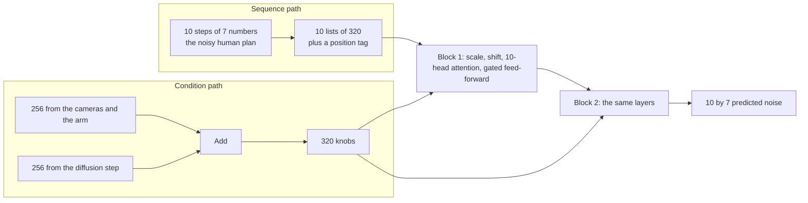

**Adaptive layer norm, zero-initialized.** Each block applies adaLN-Zero. LayerNorm inside the block has no learned affine parameters. From the 320-dimensional modulation, a linear layer produces six vectors of size 320: scale, shift, and gate for the attention branch, and the same three for the MLP branch. For a token matrix $X$,

$$
\mathrm{Modulate}(X; s, b) = X \odot (1 + s) + b,
$$

broadcast across the horizon. The attention residual is multiplied by its gate before it is added, and the feed-forward residual is gated the same way. The feed-forward width is the usual factor of four: $320 \to 1280 \to 320$, with the tanh approximation of GELU. The final readout is another conditioned LayerNorm and a linear map back to 7.

The gates and the final projection are initialized at zero. At step zero each block is an identity and the network predicts a zero residual, which is the DiT “zero” initialization. The other linear maps use Xavier uniform initialization. Conditioning therefore has to be learned as a deviation from a pass-through, rather than as a random scramble of the action tokens on the first update.

The 320-dimensional state is not a concatenation of the 7 action numbers with the 256-dimensional scene vector, and it is not the output of the ResNet. The ResNet’s contribution ends at $c$. The 320 channels are the transformer’s working width.

## Generative model

The main policy is an $\varepsilon$-prediction DDPM with $T_{\mathrm{diff}} = 50$ steps and a cosine variance schedule. Let $x_0 \in \mathbb{R}^{10 \times 7}$ be a clean normalized action chunk. A diffusion index $t$ is drawn uniformly from $\{0,\ldots,49\}$, and $\varepsilon \sim \mathcal{N}(0, I)$ is drawn at the same shape as $x_0$. The forward process is closed form. It does not iterate:

$$
x_t = \sqrt{\bar\alpha_t}\, x_0 + \sqrt{1 - \bar\alpha_t}\,\varepsilon.
$$

$\bar\alpha_t = \prod_{s=0}^{t} (1 - \beta_s)$ is the fraction of signal that survives to step $t$. The cosine schedule sets that fraction before any gradient step, following Nichol and Dhariwal, with the offset $s = 0.008$:

$$
\bar\alpha_t \propto \cos^2\!\left(\frac{t/T + s}{1+s}\cdot\frac{\pi}{2}\right),
$$

normalized so $\bar\alpha$ starts at 1, then converted to per-step $\beta_t$ and clipped at 0.999. For $T = 50$ the table is concrete. At $t = 0$, $\bar\alpha_0 \approx 0.998$ and the noise coefficient is about 0.042, so a “noisy” early example is still almost the demonstration. At $t = 24$, signal and noise have nearly equal weight ($\bar\alpha \approx 0.49$). At $t = 49$ the clean chunk has been wiped out and $\beta$ sits on the clip. The network never has to walk this chain during training. One sample of $t$ builds $x_t$ directly.

The denoiser $f_\theta(x_t, t, c)$ is the DiT above. For the main run the regression target is the noise that was added. The loss is the unweighted mean squared error, the simplified objective of Ho et al., with the original SNR-dependent loss weights dropped:

$$
\mathcal{L}(\theta) = \mathbb{E}_{x_0,\, c,\, t,\, \varepsilon}\,\big\| f_\theta(x_t, t, c) - \varepsilon \big\|_2^2.
$$

An otherwise identical run replaces the target with $x_0$ itself. Same architecture, same schedule, same data. Only the quantity being regressed changes. Those two targets are not two networks inside one policy, and they are not “training versus inference.” Each is a separate optimization. At sampling time, an $\varepsilon$-model is algebraically converted back to an estimate of $x_0$; an $x_0$-model emits that estimate directly.

Optimization uses AdamW at learning rate $10^{-4}$, batch size 64, for $10^5$ gradient steps. An exponential moving average of the weights is maintained with decay 0.995, i.e. each update keeps 99.5% of the averaged parameters and mixes in 0.5% of the current ones. Evaluation and the checkpoints that matter are the EMA weights, in eval mode, which also freezes the center-crop behavior of the randomizer. Checkpoints are written every 500 steps, and a rerun of the same command resumes from the last one.

A sigmoid schedule is the second variance table, with the construction used in `denoising-diffusion-pytorch`: $\bar\alpha_t$ follows a sigmoid from nearly 1 to nearly 0, parameterized by endpoints $-3$ and $3$ and temperature $\tau = 1$, then converted to $\beta_t$ and clipped at 0.999. Relative to cosine it spends its early indices at a higher noise level. The first-step noise coefficient is about 0.08 rather than 0.04, and the two curves meet near the middle of the chain. A linear schedule is implemented and selectable, and it was not one of the four reported runs.

Because $t$ is drawn uniformly, the stochastic gradient is dominated by the middle of the chain, where cosine and sigmoid nearly agree. The examples with a small $t$, which cosine keeps closer to $x_0$, are a minority of each epoch. They still matter at deployment, because the controller consumes the clean end of the reverse chain, not a mid-chain latent.

## Closed-loop inference

Sampling is ancestral DDPM, conditioned on one observation, for the full 50 steps. There is no classifier-free guidance and no distilled sampler.

**Step 1.** Normalize the current observation with the dataset statistics and encode it once to $c$. The encoder is not recomputed inside the denoising loop.

**Step 2.** Draw $x_T \sim \mathcal{N}(0, I)$ with shape $1 \times 10 \times 7$.

**Step 3.** For $t = 49, \ldots, 0$, predict the noise, recover a clean-chunk estimate, and take one posterior step. For an $\varepsilon$-model,

$$
\hat{x}_0 = \frac{x_t - \sqrt{1 - \bar{\alpha}_t}\, \varepsilon_\theta}{\sqrt{\bar{\alpha}_t}}.
$$

$\hat{x}_0$ is clipped to $[-1, 1]$, which is the legal range of the normalized actions. The mean of the reverse transition is the standard Gaussian posterior mean written in terms of $x_t$ and $\hat{x}_0$. For every $t \gt 0$ fresh noise is added with the posterior standard deviation. The last step is deterministic.

**Step 4.** Unnormalize the chunk into controller units.

**Step 5.** Execute the first 8 commands. Do not re-encode until those 8 steps have been applied, or the episode hits the 500-step cap.

**Step 6.** Read both cameras and the 9 proprioceptive scalars, and sample a new chunk.

The three horizons are easy to conflate, and they measure different things. Fifty is the number of denoising iterations inside a single plan. Ten is the temporal length of that plan. Eight is how much of the plan is trusted before the visual loop closes. All fifty denoising steps happen between two calls to the simulator. They are not fifty motions of the arm.

## Evaluation

Every $10^4$ gradient steps, and once more after the final checkpoint, the EMA policy is rolled out for 25 episodes from the environment’s randomized initializations. The simulator’s reward is sparse and binary: 1 on any timestep for which the square nut is seated on the brass peg, and 0 otherwise. Training does not optimize this number.

Scoring a chunked policy needs one extra reduction. The reward stays at 1 for every step the nut remains seated, so summing raw rewards would credit a long dwell as many successes. Inside each executed chunk of 8, only the maximum reward is kept. A placement therefore contributes once per chunk. The episode score is the sum of those chunk scores, and the episode is a success when that sum is positive. The reported metric is the fraction of the 25 episodes that succeed.

Behavior cloning is scored with the same success rule, episode total greater than zero, so success rates can be compared. Its per-step rewards are summed rather than max-pooled, because it has no chunk, but the binary success decision does not depend on that pooling. Losses cannot be compared across runs. An $\varepsilon$-model is scored in noise units and opens near 1. An $x_0$-model and the behavior-cloning baseline are scored in normalized-action units and open near 0.25. A lower loss is not a better robot.

Twenty-five episodes is a coarse estimator. A swing of two or three successes is a few percentage points and is within the noise of the initial-condition sample. The curves below should be read as ordered comparisons, not as precise success probabilities. Every number in the table is taken from `figures/metrics.csv`.

## Experiments

Four policies were trained on the same demonstrations for $10^5$ updates. They differ in the prediction target, the variance schedule, or whether diffusion is used at all. The visual encoder, the transformer width, the optimizer, and the data are held fixed.

| Policy | Intervention | Best of 25 | Final retest |
|---|---|---|---|
| ε-prediction, cosine schedule | Reference model | 18 (70k, 80k, and 100k) | 14 |
| ε-prediction, sigmoid schedule | Variance schedule only | 16 (70k and 80k) | 15 |
| x₀-prediction, cosine schedule | Regress the clean chunk | 19 (at 100k) | 18 |
| Behavior cloning | Single-step regression, no diffusion | 7 (at 80k) | 5 |

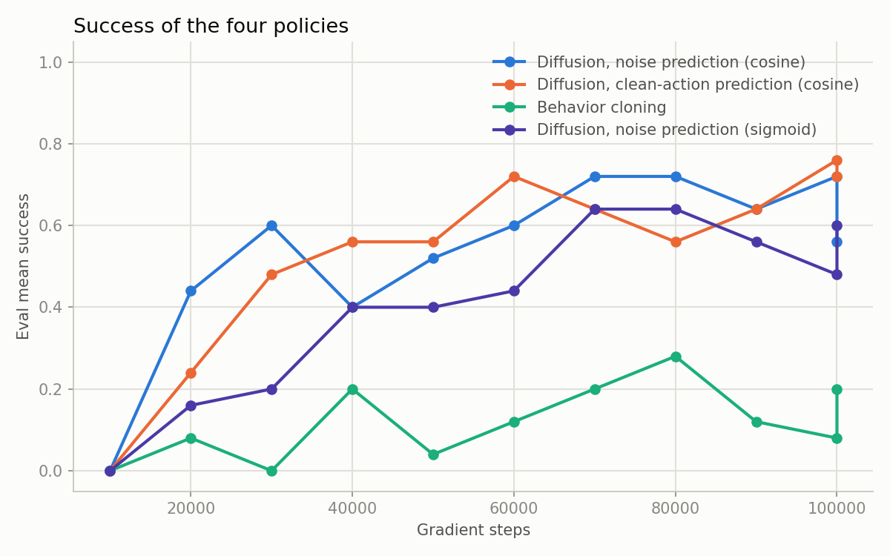

**Schedule.** Cosine reaches a usable policy earlier. At 20,000 updates the cosine $\varepsilon$-model succeeds on 11 of 25 episodes, against 4 of 25 for sigmoid and 2 of 25 for behavior cloning. By 30,000 updates the counts are 15 and 5. The mechanism is the end of $\bar\alpha_t$ where $t$ is small. Cosine leaves those examples nearly clean, so the denoiser’s easiest cases are close to the actions the robot will actually execute. Sigmoid corrupts them more aggressively. Uniform sampling of $t$ hides this in the scalar loss: the two $\varepsilon$-models track each other, and sigmoid finishes lower, 0.026 against 0.035 at step 100,000, both having started at 1.004. The lower loss does not translate into faster task success. At the final retest the two schedules are statistically close, 14 and 15 out of 25. The cosine model’s best logged rate is 18 of 25; its last independent roll is 14 of 25, which is the spread one should expect from 25 randomized episodes.

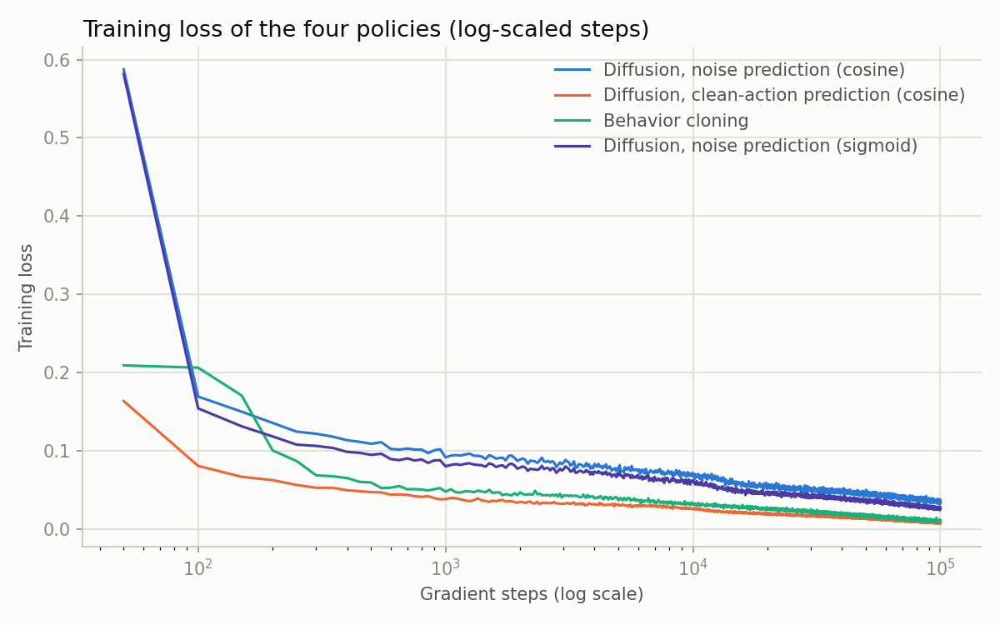

**Prediction target.** Clean-chunk regression with the same cosine table is the strongest final policy in this set: 19 of 25 at the 100,000-step checkpoint and 18 of 25 on the terminal retest. Its loss falls from 0.240 to about $7 \times 10^{-3}$. That loss is in action units, so it is not evidence that $x_0$-prediction fits “better” than $\varepsilon$-prediction. It is evidence that asking the same DiT to emit the chunk, rather than the noise, is a viable and here slightly stronger parameterization for a 50-step action model. Both parameterizations use one forward pass of the same architecture per diffusion index. Inference still runs the ancestral chain. The $x_0$ head simply skips the algebraic conversion from $\varepsilon$ to $\hat x_0$.

**Behavior cloning.** The baseline reuses both ResNets and the same DiT, including adaLN-Zero. It does not noise an action, and it does not predict a chunk. Each sample is a single action (`horizon = 1`). The sequence input and the diffusion index are fixed zeros, and the network is trained with MSE against the demonstrated action. Because every block is modulated by $c + \phi(t)$, a zero action token and a dummy time index still force the output to be a function of the real observation. There is no separate policy head. At execution it replans every environment step.

The baseline tops out at 7 of 25, at 80,000 updates, and finishes at 5 of 25. Its action-space loss falls from 0.253 to about $9.7 \times 10^{-3}$, comparable to the $x_0$ diffusion loss, while its success rate stays far below either diffusion policy. The gap is the usual one for multimodal imitation on a contact task. Several approach directions, grasp timings, and insertion alignments are consistent with the demonstrations. Squared error against a single demonstrated action averages across those modes and can produce a command that misses the bore. A diffusion model over a 10-step chunk represents that conditional distribution instead of its mean, and the chunk keeps the eight executed commands temporally consistent with one another.

<p align="center">
  
</p>

## What this system is not

A few standard ingredients of image diffusion are absent here, on purpose.

The denoiser is not a U-Net over pixels, and it is not a DiT over VAE latents. The quantity being diffused is a 10-by-7 action, already low-dimensional, so there is no autoencoder and no spatial downsampling inside the generative model. The ResNets are an observation encoder, analogous to a text encoder’s role as a condition, not to the trunk that carries the noisy sample.

There is no classifier-free guidance. The condition $c$ is always the true observation, in training and at sampling. Dropping it would ask the model to produce an action chunk for no scene, which is not a useful unconditional prior for this task.

The horizon of 50 is the diffusion horizon. Image models often use on the order of $10^3$ steps, or a learned scheduler that skips most of them. Fifty steps is enough for a smooth trajectory in $\mathbb{R}^{70}$ and is cheap enough to run inside a 20 Hz control loop’s planning budget, with the visual encoder called once per replan rather than once per denoising step.

## Code

| Path | Role |
|---|---|
| `diffusion_policy.py` | Train and evaluate the diffusion policy |
| `ddpm.py` | Variance schedule, ε or x₀ loss, ancestral sampler, EMA |
| `bc.py` | Behavior-cloning baseline on the same ResNets and the same DiT |
| `networks/vision_condition.py` | Two ResNet-18 encoders, GroupNorm, crop, 256-dimensional mixer |
| `networks/dit1d.py` | Two-block diffusion transformer with Fourier time and adaLN-Zero |
| `utils/dataset.py` | One observation paired with a 10-action chunk, zarr replay buffer |
| `utils/common.py` | Cosine, sigmoid, and linear schedules, simulator wrapper, CSV logger |
| `train_all.py` | ε-prediction, x₀-prediction, then behavior cloning |
| `plot_completion_vs_gradient_steps.py` | Success rate against gradient step |
| `plot_diffusion_generation.py` | Reverse-process visualization of one denoised chunk |
| `figures/` | Assembly clip, workspace and camera views, loss, success, `metrics.csv` |

## Setup

Robomimic is installed from the v0.4.0 tag so the environment metadata in the demonstration file matches this stack. The PyPI releases drift from that metadata.

```bash
python -m venv .venv
source .venv/bin/activate
pip install -r requirements.txt
git clone --depth 1 --branch v0.4.0 https://github.com/ARISE-Initiative/robomimic.git /tmp/robomimic_src
pip install --no-deps /tmp/robomimic_src
```

The pinned simulator stack in `requirements.txt` is Robosuite 1.4.1 and MuJoCo 3.1.6. On macOS the offscreen renderer needs `MUJOCO_GL=cgl`. The training script selects that backend when it is unset.

Download the proficient-human image demonstrations (about 2.6 GB):

```bash
mkdir -p data/robomimic/datasets/square/ph
curl -L -o data/robomimic/datasets/square/ph/image.hdf5 \
  https://downloads.cs.stanford.edu/downloads/rt_benchmark/square/ph/image.hdf5
```

The first training process converts that HDF5 into a zarr replay buffer beside the run. Later runs reuse it.

## Train

The four reported configurations:

```bash
python diffusion_policy.py
python diffusion_policy.py --predict_x0
python diffusion_policy.py --beta_schedule sigmoid
python bc.py
```

`diffusion_policy.py` with no flags is the reference model: $\varepsilon$-prediction, cosine schedule, horizon 10, 8 actions executed, 50 diffusion steps, batch 64, AdamW at $10^{-4}$, 100,000 updates, EMA decay 0.995. `--predict_x0` switches the regression target to the clean chunk and keeps the cosine schedule. `--beta_schedule sigmoid` keeps $\varepsilon$-prediction and swaps only the $\bar\alpha_t$ table. `bc.py` trains the single-step regression baseline.

Each run writes checkpoints under `results/` and resumes if the command is repeated. Evaluation fires every 10,000 updates for 25 episodes, plus a terminal evaluation. An episode is a success when the square nut is recorded on the brass peg. `results/` and `*.pt` are gitignored. The logged curves in this repository live in `figures/`.

```bash
python plot_completion_vs_gradient_steps.py
```
